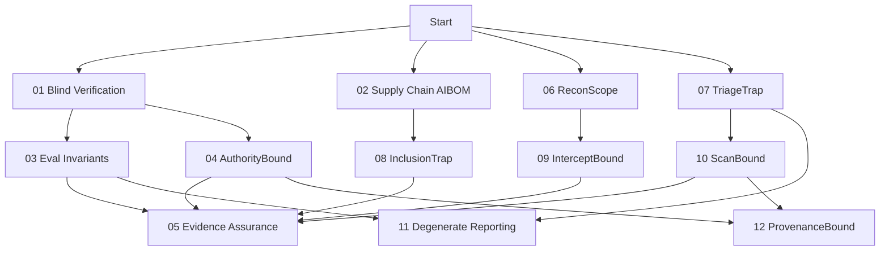

# Demos Overview

The catalogue now covers **47 demos**: 12 course-format modules (01–12, with full labs) and 35 short-format teaching toys (13–47, ~30 min each). The path diagram below shows the core progression through the 12 course modules; see the Quick Comparison table for all 47.

## Learning Path (core modules 01–12)

## Quick Comparison

| Demo | Core Concept | Key Insight | Time |
|------|--------------|-------------|------|
| **01** | Blind Verification | Commit before seeing test | 30 min |
| **02** | AIBOM Drift | Policy gates prevent drift | 30 min |
| **03** | Eval Invariants | 5 checks for robust eval | 45 min |
| **04** | Authority Bound | Provenance = authority | 45 min |
| **05** | Evidence Assurance | Hash chains + Merkle trees | 45 min |
| **06** | ReconScope | Network data ≠ instructions | 30 min |
| **07** | TriageTrap | Metadata ≠ authority | 30 min |
| **08** | InclusionTrap | Reading ≠ executing | 45 min |
| **09** | InterceptBound | Taint tracking blocks actions | 45 min |
| **10** | ScanBound | Scope + taint = safe scanning | 45 min |
| **11** | Degenerate Reporting | Baselines that rule out doing nothing | 15 min |
| **12** | ProvenanceBound | Provenance-aware calendar authorization | 20 min |
| **13** | Typed Commitments | Shared wrong cue defeats agreement | 30 min |
| **14** | Conformal Gating | Guarantee breaks under shift | 30 min |
| **15** | Hijack Probes | Borderline episode slips below threshold | 30 min |
| **16** | Infection Spread | Structure beats the average (R0) | 30 min |
| **17** | Report Fidelity | Claims have deterministic log predicates | 30 min |
| **18** | Crosslingual Gap | Language transfer defeats phrasing detectors | 30 min |
| **19** | Lineage Risk | Inherited flags flow downhill | 30 min |
| **20** | Agent Web Census | Adoption by a site is not exposure | 30 min |
| **21** | MCP Ecosystem | Registry drift and poisoned descriptions | 30 min |
| **22** | Memory Leakage | Kept, reshown, undererased | 30 min |
| **23** | Fault Injection | Retries absorb everything but the permanent fault | 30 min |
| **24** | Delegation Checks | Audience binding + no scope growth | 30 min |
| **25** | Attestation Verifier | Fail-closed vs fail-open installs | 30 min |
| **26** | Sandbox Probes | Process boundaries miss network and env | 30 min |
| **27** | CI Trigger Scan | Public trigger + write permission + no review | 30 min |
| **28** | Memory Poisoning | Stored entries steer later actions | 30 min |
| **29** | Provenance Graphs | Orphans cannot be attributed | 30 min |
| **30** | Insecure Defaults | Three-clause rule finds 6/10 insecure | 30 min |
| **31** | Scope Creep | Only requesting less removes creep | 30 min |
| **32** | Reproducibility Audit | Reproducing implies sharing artefacts | 30 min |
| **33** | Protocol Coverage | Known attack without stated mitigation | 30 min |
| **34** | Visual Injection | Region defense is perfect but not free | 30 min |
| **35** | Scaling Metaregression | The suite explains more than size | 30 min |
| **36** | Model Card Debt | The tail carries the debt | 30 min |
| **37** | Detector Cost | Costs, not accuracy, pick the operating point | 30 min |
| **38** | Assurance Claims | Third-party evidence is the thinnest | 30 min |
| **39** | Incident Taxonomy | Counts need a tie-break rule | 30 min |
| **40** | Corpus Union | Dedupe decides what it is; licences what it may become | 30 min |
| **41** | Ten Invariants | No invariant without accepted evidence | 30 min |
| **42** | Patch Lifecycle | Median adoption lag 37.5 days; pins block fixes | 30 min |
| **43** | Terms Coding | Accountability burden slides downhill | 30 min |
| **44** | Toolflow Taint | Labels do not travel across tool hops | 30 min |
| **45** | Exact Nulls | The null decides what the count means | 30 min |
| **46** | Embedding Drift | Orthogonal swap dwarfs the frozen mean | 30 min |
| **47** | Pre-Reveal Seal | A later edit is not a new answer | 30 min |

## Common Themes

| Theme | Demos | Key Lesson |
|-------|-------|------------|
| **Provenance Tracking** | 04, 06, 07, 08, 09, 10, 12, 19, 29, 44 | Data source determines authority |
| **Fail-Closed Defaults** | 02, 04, 08, 09, 10, 12, 14, 25 | Default deny, explicit allow |
| **Blind Evaluation** | 01, 03, 11, 13, 15, 45, 47 | No peeking at test conditions; seals and exact nulls |
| **Scope Enforcement** | 02, 04, 06, 08, 10, 12, 24, 26, 31 | Explicit allowlists only |
| **Taint Tracking** | 09, 10, 44 | Track data source through pipeline |
| **Oracle Separation** | 01, 11, 12, 17 | Labels never drive attempts; claims checked against logs |
| **Cryptographic Evidence** | 05, 29, 47 | Hash chains, Merkle trees, pre-reveal seals |
| **Supply Chain Safety** | 02, 21, 25, 27, 30, 31, 40, 42, 46 | Registries, attestations, pins, defaults |
| **Agent Memory** | 22, 28 | Leakage (privacy) is not poisoning (integrity) |
| **Documentation & Accountability** | 36, 38, 39, 43 | Cards, claims, incidents and terms under audit |
| **Evaluation Methodology** | 03, 11, 14, 32, 33, 35, 37, 41 | Valid measurements need baselines, nulls and costs |
| **Detection Limits** | 13, 15, 18, 22, 23, 24, 26, 28, 34, 37, 39 | Toys demonstrate mechanisms; refuse overclaims |

## Prerequisites by Demo

| Demo | Python Concepts | Security Concepts |
|------|-----------------|-------------------|
| 01 | JSON, subprocess, hashing | Authorization, dependencies |
| 02 | Sets, pattern matching | Supply chain, policy gates |
| 03 | Statistics, JSON | Evaluation methodology |
| 04 | Enums, dataclasses | Confused deputy, capabilities |
| 05 | Hashing, crypto, Merkle trees | Cryptographic evidence |
| 06 | Regex, IP parsing | Network protocols, injection |
| 07 | Bayes theorem, enums | Malware triage, base rates |
| 08 | Path resolution, AST | File inclusion, LFI/RFI |
| 09 | Dataclasses, enums | Taint tracking, MITM |
| 10 | AST parsing, regex | Vuln scanning, scope control |
| 11 | Dataclasses, JSON | Meta-science: baselines, base rates, metric sanity |
| 12 | Regex, Unicode normalization, dataclasses | Provenance-aware authorization, oracle separation |
| 13 | Dataclasses, enums | Agreement gates, redundancy |
| 14 | Statistics, JSON | Conformal risk control, coverage |
| 15 | Floats, thresholds | Probing, false positives |
| 16 | Graphs, BFS | Epidemic spread, R0, containment |
| 17 | Logs, JSON | Claims-vs-logs auditing |
| 18 | Strings, dictionaries | Injection, language transfer |
| 19 | Graph traversal | Model lineage, inherited risk |
| 20 | Counting, tallying | Census, adoption vs exposure |
| 21 | Versions, dictionaries | Registries, rug pulls |
| 22 | JSON, sets | Contextual integrity, retention, erasure |
| 23 | State machines | Dependability, fault injection |
| 24 | Lists, validation | Delegation, audience and scope binding |
| 25 | Sets, policy checks | Attestations, fail-closed installs |
| 26 | Dictionaries | Sandboxing, escape ladders |
| 27 | YAML, wiring checks | CI triggers, permissions, review |
| 28 | Strings, patterns | Stored injection, memory integrity |
| 29 | Graphs, hashing | Forensics, tamper evidence |
| 30 | Parsing, sets | Insecure defaults, pinning |
| 31 | Set operations | Least privilege, OAuth scopes |
| 32 | JSON, tables | Reproducibility, artefact audits |
| 33 | Dictionaries | Protocol elements, mitigation gaps |
| 34 | Regions, flags | Visual prompt injection |
| 35 | Means, grouping | Meta-analysis, confounders |
| 36 | Ranking, counting | Documentation debt |
| 37 | Cost arithmetic | Thresholds, asymmetric costs |
| 38 | Coding tables | Assurance obligations |
| 39 | Tallying, sorting | Incident taxonomies, controls |
| 40 | Hashing, normalization | Deduplication, licence gates |
| 41 | Checklists | Security invariants, synthesis |
| 42 | Medians, sorting | Fix-to-adoption gap, version pins |
| 43 | Coding sheets | Accountability clauses |
| 44 | Graphs, labels | Toolflow taint, sensitive sinks |
| 45 | Combinatorics | Hypergeometric null, significance |
| 46 | Cosine similarity | Embedding drift |
| 47 | Hashing, chaining | Commitment seals |

## Recommended Order

### First Time (Beginner)
1. **01** Blind Verification — Foundation: commitment before test
2. **02** Supply Chain AIBOM — Policy gates, drift detection
3. **06** ReconScope — Network data is observation, not instruction
4. **07** TriageTrap — Metadata ≠ authority

### Intermediate
5. **03** Eval Invariants — Robust evaluation design
6. **04** Authority Bound — Provenance = authority
7. **08** InclusionTrap — Reading ≠ executing
8. **09** InterceptBound — Taint tracking in pipelines

### Advanced
9. **05** Evidence Assurance — Cryptographic pipelines
10. **10** ScanBound — Scope + taint for safe automation
11. **11** Degenerate Reporting — Audit any evaluation, including your own
12. **12** ProvenanceBound — Provenance-aware authorization for untrusted content

### Short-Format Toys (13–47)
Each is one teaching toy (~30 min, standard library only): run the tests, run the script, read the table.
1. **13–17, 19–21** — Pipeline and intelligence toys: agreement gates, conformal gating, probes, spread, claims-vs-logs, lineage, censuses
2. **22–34, 36–44** — Capability, memory, supply-chain and documentation toys: injection channels, leakage, faults, delegation, attestations, sandboxes, defaults, coding exercises, lifecycle
3. **45–47** — Measurement toys: exact nulls, embedding shifts, pre-reveal seals (pairs with 01)

## Cross-Demo Exercises

See [examples/](../examples/) for cross-demo integration exercises:
- Blind verification + Evidence assurance pipeline
- ReconScope + ScanBound coordinated scanning
- Authority Bound + InclusionTrap provenance chains

## Assessment Ideas

| Demo | Quiz Question | Practical Exercise |
|------|---------------|-------------------|
| 01 | Why is post-hoc explanation insufficient? | Add new scenario + oracle |
| 02 | How does waiver override deny? | Add new drift scenario |
| 03 | What does "leakage" mean? | Implement n-gram metric |
| 04 | What is confused deputy? | Add new tool + capability |
| 05 | What prevents tampering? | Add Merkle proof verification |
| 06 | Why is network data untrusted? | Add new protocol parser |
| 07 | What is base-rate fallacy? | Tune quarantine threshold |
| 08 | Reading vs executing? | Add nested inclusion test |
| 09 | What is taint tracking? | Add new frame type |
| 10 | How does scope prevent drift? | Add out-of-scope target |
| 11 | What rules out doing nothing? | Score the degenerate policy |
| 12 | Why must provenance beat the detector? | Add a paraphrase the detector misses |
| 13 | When does agreement pass a wrong answer? | Add a third cue level |
| 14 | What breaks conformal coverage? | Add a second shifted episode set |
| 15 | Why is h4 missed? | Move the threshold and recount |
| 16 | Why does containment hold when R0 > 1? | Add a fifth topology |
| 17 | Which claims verify without humans? | Add a fourth rule |
| 18 | Why do EN detectors miss translations? | Add an AR faithful translation |
| 19 | How does a parent's flag reach a clean child? | Add a merge-of-merges case |
| 20 | Does high adoption mean high exposure? | Add a site adopted + exposed |
| 21 | What makes a description poisonous? | Add an 8th server with hidden text |
| 22 | Which entries must never persist? | Add a cross-user resurface case |
| 23 | Which faults survive retries? | Add a duplicate-delivery fault |
| 24 | What are the two delegation properties? | Add a chain that flips audience twice |
| 25 | Fail-closed vs fail-open: who installs malware? | Add an attested-but-malicious package |
| 26 | What leaks past a process boundary? | Add a signal probe |
| 27 | What three features create CI risk? | Add a repo with review required |
| 28 | How does stored memory steer an agent? | Add a benign-safe entry |
| 29 | Why is a5 unattributable? | Add a witness record for a5 |
| 30 | Which three clauses flag a stack? | Add a publicly bound stack without auth |
| 31 | How do you remove scope creep? | Add an integration requesting 5 unused scopes |
| 32 | What does a reproducibility audit check? | Add a paper that shares code but not data |
| 33 | What makes a protocol gap? | Add an element with attack and no mitigation |
| 34 | What does the region defense cost? | Add a benign untrusted image that is safe |
| 35 | Why can benchmark choice dwarf scale? | Add rows for a third benchmark |
| 36 | Where does documentation debt sit? | Move c03 down the ranking |
| 37 | Why is the noisy detector cheaper? | Set FP cost = 25, FN cost = 10 |
| 38 | Which obligation is thinnest? | Flip one card's third_party flag |
| 39 | Why does a tally need a tie-break rule? | Shift inc10 and re-run |
| 40 | What order: dedupe or licence-gate? | Add a by-sa duplicate |
| 41 | What qualifies an invariant? | Add a violated isolation check |
| 42 | What blocks a quarter of fixes? | Raise vuln07's lag |
| 43 | Which clause is rarest? | Code a 9th platform record |
| 44 | Do labels travel across tool hops? | Add a labelled network flow |
| 45 | What decides if a count is significant? | Shrink the pool and recompute p |
| 46 | What does cosine shift measure? | Swap in a half-rotated vector |
| 47 | Why is an edit after sealing invalid? | Re-seal before revealing |

## Assessment Rubric

| Level | Criteria |
|-------|----------|
| **Pass** | All tests pass, safety verified, results recorded |
| **Good** | Exercises completed, can explain key concepts |
| **Excellent** | Extensions implemented, can teach to others |

---

*Each demo includes beginner/standard/extension exercises in its `tests/` directory.*